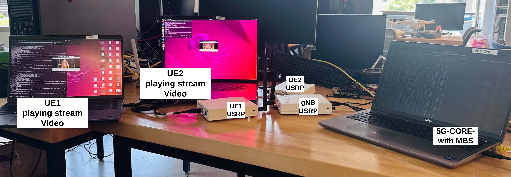
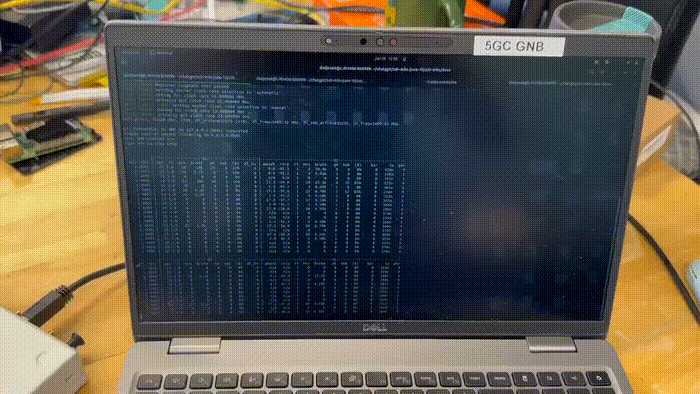

# End-to-End 5G MBS over SDR

This repository contains an end-to-end 5G Multicast/Broadcast Services (MBS)
prototype that connects a 5G-MAG/Open5GS core, an OCUDU-based gNB, OAI nrUEs,
and an AF/AS traffic source. The system is used to broadcast either short text
messages or MPEG-TS video over the 5G MBS user-plane path and deliver the same
MTCH transmission to one or more UEs over SDR.

The current over-the-air setup uses a shared MBS downlink bearer scheduled by
the gNB with G-RNTI `0xfe01`. The AF/AS creates an MBS broadcast session through
MB-SMF, obtains the multicast tunnel assigned by the core, sends GTP-U packets
to that tunnel, and the gNB maps the traffic to MTCH for radio transmission.



*Figure 1. End-to-end SDR testbed used for 5G MBS PTM broadcast experiments. The setup connects the 5G-MAG, OCUDU gNB, AF/AS traffic source, and srsRAN or oai nrUE receivers over the live radio path.*

Here is the video recording with Sound:
[](https://github.com/rajendra1124/e2e5Gmbs/raw/main/images/PTM-video-delivery-comp.mp4)


*Figure 2. Live 5G MBS video broadcast demo with Point-to-Multipoint*




*Figure 3. Live 5G MBS text broadcast demo. The AF/AS sends timestamped `testMsg N Tx_ns=<timestamp>` payloads through the MBS tunnel, and the same MTCH transmission is received by both UEs over G-RNTI `0xfe01`.*

## Project Structure

The full working tree is organized around the folder names used in
`/home/dwijesek/git/e2e5Gmbs`:

```text
e2e5Gmbs/
├── 5G-MAG-Core/
├── OCUDU-gNB/
├── oai-ue/
├── docs/
└── images/
```

<details>
<summary><strong>5G-MAG-Core/</strong> - 5G-MAG/Open5GS MBS core, AF/AS, and Docker environment</summary>

```text
5G-MAG-Core/
├── compose-files/
│   ├── external/
│   └── internal/
├── configs/
│   ├── external/
│   └── internal/
├── express-mock-media-server/
├── images/
├── insomnia/
├── postman/
├── scripts/
└── test/
    ├── media/
    └── tools/
        ├── mbs_text_stream.py
        └── mbs_video_stream.py
```
</details>

<details>
<summary><strong>OCUDU-gNB/</strong> - OCUDU gNB source, MBS scheduler changes, and build output</summary>

```text
OCUDU-gNB/
├── apps/
├── build/
│   └── apps/
│       └── gnb/
├── cmake/
├── configs/
├── docker/
├── external/
├── include/
├── lib/
├── scripts/
├── tests/
└── utils/
```
</details>

<details>
<summary><strong>oai-ue/</strong> - OAI nrUE source and UE-side MBS receiver support</summary>

```text
oai-ue/
├── charts/
├── ci-scripts/
├── cmake_targets/
├── common/
├── doc/
├── docker/
├── executables/
├── fronthaul/
├── nfapi/
├── openair1/
├── openair2/
├── openair3/
├── openshift/
├── radio/
├── targets/
├── tests/
└── tools/
```
</details>

<details>
<summary><strong>docs/</strong> - run scripts, configuration notes, measurements, and paper artifacts</summary>

```text
docs/
├── README.md
├── run-gnb.sh
├── run-gnb-text.sh
├── activate-live-mbs.sh
├── activate-text-mbs.sh
├── restart-mbs-nfs.sh
├── ue-internet-forwarding.sh
├── ocudu-host-gnb-b210.yml
├── mbs-measure.sh
├── measurement/
└── *.md, *.tex, *.bib, *.html
```
</details>

<details>
<summary><strong>images/</strong> - figures and screenshots used by the README and paper material</summary>

```text
images/
└── README and paper figures
```
</details>

## Component Roles

`5G-MAG-Core/`
Contains the containerized 5G core and AF/AS environment. The important runtime
containers are:

- `db`: MongoDB subscriber database.
- `nrf`, `ausf`, `udm`, `udr`, `nssf`, `bsf`, `pcf`: Open5GS control-plane NFs.
- `amf_with_mbs`: AMF with MBS-related support.
- `smf_mb-smf`: MB-SMF that creates MBS broadcast sessions and allocates TMGI.
- `upf_mb-upf`: MB-UPF that anchors MBS user-plane traffic.
- `test_mbs_af_as`: AF/AS test container that creates sessions and sends media.

`OCUDU-gNB/`
Contains the OCUDU gNB implementation and build artifacts. The gNB connects to
the AMF over NGAP/N2, receives the MBS tunnel information, joins the assigned
multicast group, accepts GTP-U G-PDUs from the AF/AS path, and schedules the MBS
traffic on MTCH using G-RNTI `0xfe01`.

`oai-ue/`
Contains the OAI nrUE implementation. The UE registers through the 5G core and
receives MBS downlink traffic over the SDR radio path. In the tested setup, two
UEs use different IMSIs, for example:
- `999700000168430`
- `999700000168431`

`docs/`
Contains the operational scripts and measurement material used to run and
evaluate the text and video broadcast experiments.

## Docs Scripts
### `run-gnb.sh`
Starts the OCUDU gNB with the B210 SDR configuration in
`ocudu-host-gnb-b210.yml`.

It also applies host-side real-time tuning before starting the gNB:
- Stops any existing OCUDU gNB process.
- Rotates stale `/tmp/ocudu_gnb_sdr.*` runtime files.
- Disables deeper CPU C-states.
- Sets larger network socket buffers.
- Stops `irqbalance`.
- Pins IRQs away from the gNB CPU set.
- Starts the gNB with `taskset -c 4-7,12-15`.
- Starts the gNB with `SCHED_FIFO` priority `50`.
By default it also auto-runs `activate-live-mbs.sh` after the gNB connects to
the AMF. This means `run-gnb.sh` is the normal entry point for video streaming.

Common environment variables:
```bash
AUTO_ACTIVATE=1             # default: automatically activate video MBS
AUTO_ACTIVATE=0             # start only the gNB, do not activate MBS
BITRATE_KBPS=220            # video MPEG-TS payload bitrate
ACTIVATE_DELAY=2            # seconds before checking AMF connection
ACTIVATE_READY_TIMEOUT=90   # max wait for gNB/AMF connection
```

### `run-gnb-text.sh`
Starts the gNB for text broadcast instead of video broadcast. It wraps
`run-gnb.sh`, disables video auto-activation, and starts `activate-text-mbs.sh`
in the background after the gNB connects to the AMF.

Common environment variables:
```bash
TEXT_PREFIX=testMsg         # payload prefix
TEXT_INTERVAL=1             # seconds between messages
TEXT_DURATION=1800          # total send duration, 1800 seconds = 30 minutes
TEXT_START=1                # first message number
ACTIVATE_DELAY=2
ACTIVATE_READY_TIMEOUT=90
```

The text payload format is:
```text
testMsg N Tx_ns=<timestamp>
```

For example:
```text
testMsg 152 Tx_ns=1783962000000000000
```
### `activate-live-mbs.sh`
Creates and activates a live video MBS broadcast session while the gNB is already
running.

It performs these steps:
1. Calls the AF/AS test code inside `test_mbs_af_as`.
2. Creates a fresh MBS broadcast session through MB-SMF.
3. Waits for the gNB log to show the assigned multicast group and TEID.
4. Stops any existing video sender.
5. Starts `mbs_video_stream.py` inside the AF/AS container.
6. Verifies that the gNB schedules MTCH/PDCCH/PDSCH with G-RNTI `0xfe01`.

Common environment variables:
```bash
AF_CONTAINER=test_mbs_af_as
GNB_LOG=/tmp/ocudu_gnb_sdr.log
MEDIA_FILE=/test/media/demo.ts
BITRATE_KBPS=220
ACTIVATE_TIMEOUT=30
VERIFY_TIMEOUT=20
```

### `activate-text-mbs.sh`
Creates and activates a text MBS broadcast session while the gNB is already
running.

It performs the same MBS session setup as `activate-live-mbs.sh`, but starts
`mbs_text_stream.py` instead of the video sender. It also stops any existing text
or video sender first so only one AF/AS stream is active on the MBS tunnel.

Common environment variables:
```bash
TEXT_PREFIX=testMsg
TEXT_INTERVAL=1
TEXT_DURATION=1800
TEXT_START=1
AF_CONTAINER=test_mbs_af_as
GNB_LOG=/tmp/ocudu_gnb_sdr.log
ACTIVATE_TIMEOUT=30
VERIFY_TIMEOUT=30
```

### `restart-mbs-nfs.sh`
Restarts the MBS-specific core network functions:

```text
smf_mb-smf upf_mb-upf amf_with_mbs
```
This clears accumulated MBS sessions and frees the MB-SMF TMGI pool. It is useful
after many repeated activation attempts because the AF/AS test path skips MBS
session release cleanup due to a known container crash on release.

After running this script, restart the gNB so it reconnects to the AMF and
receives fresh MBS session state.

### `ue-internet-forwarding.sh`
Enables or removes host-side IPv4 forwarding/NAT rules for UE internet access.
This is separate from the MBS broadcast path, but useful when validating normal
UE PDU session connectivity.

Common environment variables:
```bash
UE_SUBNET=10.45.0.0/16
UPF_NEXTHOP=10.33.33.3
CORE_IFACE=br-5g-mag
WAN_IFACE=<auto-detected by default>
```

### `mbs-measure.sh`
Parses the OCUDU gNB log and generates measurement CSV files. It extracts MTCH
throughput, TBS distribution, slot usage, GTP-U ingest rate, RLC backlog, PDCP
drops, and RF underrun events.

Usage:
```bash
docs/mbs-measure.sh [GNB_LOG] [OUTDIR]
```

Defaults:
```bash
GNB_LOG=/tmp/ocudu_gnb_sdr.log
OUTDIR=/tmp/mbs-meas-<timestamp>
```

### `ocudu-host-gnb-b210.yml`
OCUDU gNB runtime configuration for the USRP B210 SDR setup. This file defines
the radio and gNB parameters used by `run-gnb.sh`.

## AF/AS Sender Tools
The AF/AS container mounts the project `test/` directory at `/test`.

### `mbs_text_stream.py`
Sends incrementing text messages as GTP-U G-PDUs to the active MBS multicast
tunnel.

Payload format:
```text
<prefix> <N> Tx_ns=<timestamp>
```

The transmit timestamp is written inside the payload and also logged to:
```text
/tmp/mbs_text_stream.csv
```

inside the `test_mbs_af_as` container.

### `mbs_video_stream.py`
Streams an aligned MPEG-TS file over the active MBS multicast GTP-U tunnel. It
reads a `.ts` file, groups up to seven 188-byte TS packets per GTP-U datagram,
paces transmission by target bitrate, and loops the video when `--loop` is used.

The default video activation uses:
```text
/test/media/demo.ts
```

inside the AF/AS container.

## Prerequisites
The setup assumes:
- Docker and Docker Compose are installed.
- The 5G-MAG/Open5GS MBS core containers are built or pullable.
- The OCUDU gNB is built at `OCUDU-gNB/build/apps/gnb/gnb`.
- The OAI nrUE is built on each UE host.
- A USRP B210 is connected to the gNB host.
- The B210 is connected through USB3.

Check the B210 link speed before running SDR experiments:

```bash
lsusb -t
```
The B210 must appear at `5000M` or faster. If it appears at `480M`, it is running
at USB2 speed and the gNB will likely show RF underflow, overflow, late samples,
and skipped slots.

Useful gNB log check:
```bash
rg 'Real-time failure in RF|DL task queue is full|Received late|Detected skipped slot|MTCH: rnti=0xfe01' /tmp/ocudu_gnb_sdr.log
```

## Installation
### 1. Install System Packages
Install the common host tools first:
```bash
sudo apt update
sudo apt install -y \
  git curl ca-certificates gnupg lsb-release \
  build-essential cmake ninja-build pkg-config \
  python3 python3-pip python3-venv \
  linux-tools-common linux-tools-generic \
  uhd-host libuhd-dev
```
Install Docker Engine, Docker Compose, and Docker Buildx using the Docker
instructions for the host OS. After installation, verify:
```bash
docker --version
docker compose version
docker buildx version
```

For SDR hosts, verify that UHD sees the USRP:
```bash
uhd_find_devices
lsusb -t
```
The B210 should show `5000M` or faster in `lsusb -t`.

### 2. Install and Build `5G-MAG-Core`
`5G-MAG-Core` contains the 5G-MAG/Open5GS core, MBS core network functions,
AF/AS test container, Docker compose files, and sender tools.
```bash
cd ~/e2e5Gmbs/5G-MAG-Core
```

Create or edit the `.env` file used by Docker Compose. At minimum, set the host
IP address that the UPF/MB-UPF should use:
```bash
DOCKER_HOST_IP=<your-host-ip-address>
```

If the container images are already available from GHCR, building locally is not
required. If local images are needed, build them with:
```bash
docker buildx bake
```
Start the external SDR core deployment:
```bash
docker compose -f compose-files/external/docker-compose.yaml --env-file=.env up -d
```
Check the containers:
```bash
docker ps --format 'table {{.Names}}\t{{.Status}}\t{{.Ports}}'
```
Stop the core with:
```bash
docker compose -f compose-files/external/docker-compose.yaml --env-file=.env down
```
Use the internal deployment only for the containerized test environment:
```bash
docker compose -f compose-files/internal/docker-compose.yaml --env-file=.env up -d
```
### 3. Install and Build `OCUDU-gNB`
`OCUDU-gNB` contains the SDR gNB used for the over-the-air MBS experiments.
The expected runtime binary is:
```text
OCUDU-gNB/build/apps/gnb/gnb
```
Configure and build the gNB:
```bash
cd ~/e2e5Gmbs/OCUDU-gNB
cmake -B build -S . -DCMAKE_BUILD_TYPE=Release -DENABLE_UHD=ON
cmake --build build --target gnb -j"$(nproc)"
```

Verify the binary exists:
```bash
ls -l build/apps/gnb/gnb
```
The `docs/run-gnb.sh` script expects this binary layout and uses:
```text
../OCUDU-gNB/build/apps/gnb/gnb
```
relative to the `docs/` directory in the GitHub repository.
```bash
cd ~/e2e5Gmbs
grep 'GNB_BIN=' docs/run-gnb.sh
```
Expected:
```bash
GNB_BIN="$(readlink -f "$SCRIPT_DIR/../OCUDU-gNB/build/apps/gnb/gnb")"
```
### 4. Install and Build `oai-ue`
`oai-ue` contains the OAI nrUE used on the UE machines. Build it on each UE host
that will run an SDR UE.

Install OAI dependencies and USRP support:
```bash
cd ~/e2e5Gmbs/oai-ue/cmake_targets
./build_oai -I --install-optional-packages -w USRP
```
Build the 5G nrUE:
```bash
./build_oai -w USRP --nrUE --ninja
```
Verify the binary exists:
```bash
ls -l ~/e2e5Gmbs/oai-ue/cmake_targets/ran_build/build/nr-uesoftmodem
```
For MBS reception, the UE runtime environment should include:
```bash
export OAI_NRUE_MBS_G_RNTI=0xfe01
```
Each UE must use a unique IMSI in its UE configuration. For the current two-UE
testbed, use:
```text
UE1: 999700000168430
UE2: 999700000168431
```
### 5. Install `docs` Runtime Scripts
The `docs` folder contains the top-level run scripts. Make sure the scripts are
executable:
```bash
cd ~/e2e5Gmbs/docs
chmod +x run-gnb.sh run-gnb-text.sh activate-live-mbs.sh activate-text-mbs.sh
chmod +x restart-mbs-nfs.sh ue-internet-forwarding.sh mbs-measure.sh
```
Before the first SDR run, confirm:
```bash
ls -l ../OCUDU-gNB/build/apps/gnb/gnb
docker ps
uhd_find_devices
lsusb -t
```
## Subscriber Setup
Add or update UE subscribers in MongoDB before running the UEs. The helper file
`create-user.txt` shows the MongoDB command format.

Example for IMSI `999700000168431`:
```bash
docker exec db mongosh open5gs --quiet --eval '
  const imsi = "999700000168431";
  db.subscribers.updateOne(
    { imsi },
    {
      $set: {
        imsi,
        msisdn: [],
        security: {
          k: "AE161E7AAC4FEB0BE1519C37243A3ADA",
          op: null,
          opc: "2E303F9C0D27E0FB8B411BCDCC4DEC3C",
          amf: "8000",
          sqn: 0
        },
        ambr: {
          uplink: { value: 1, unit: 3 },
          downlink: { value: 1, unit: 3 }
        },
        slice: [{
          sst: 1,
          sd: "ffffff",
          default_indicator: true,
          session: [{
            name: "internet",
            type: 3,
            pcc_rule: [],
            ambr: {
              uplink: { value: 1, unit: 3 },
              downlink: { value: 1, unit: 3 }
            },
            qos: {
              index: 9,
              arp: {
                priority_level: 8,
                pre_emption_capability: 1,
                pre_emption_vulnerability: 1
              }
            }
          }],
          ambr: {
            uplink: { value: 1, unit: 3 },
            downlink: { value: 1, unit: 3 }
          }
        }],
        access_restriction_data: 32,
        subscriber_status: 0,
        network_access_mode: 0
      }
    },
    { upsert: true }
  )
'
```
Check the two test subscribers:
```bash
docker exec db mongosh open5gs --quiet --eval \
  'db.subscribers.find({imsi:{$in:["999700000168430","999700000168431"]}}, {_id:0,imsi:1,slice:1}).toArray()'
```
If a subscriber is added while the core is already running, the full 5G core
usually does not need a restart. Restart the UE registration first. Restart the
MBS NFs only when MBS session allocation or stale MBS context state is suspected.

## Running the Core
From the `5G-MAG-Core` directory, start the Docker core. The exact compose file
depends on whether the gNB is external SDR or a fully containerized internal
test.

For the external SDR setup:
```bash
cd 5G-MAG-Core
docker compose -f compose-files/external/docker-compose.yaml up -d
```
For the internal/containerized setup:
```bash
cd 5G-MAG-Core
docker compose -f compose-files/internal/docker-compose.yaml up -d
```
Check that the key containers are running:
```bash
docker ps --format 'table {{.Names}}\t{{.Status}}\t{{.Ports}}'
```
Useful logs:
```bash
docker logs --tail 80 amf_with_mbs
docker logs --tail 80 smf_mb-smf
docker logs --tail 80 upf_mb-upf
docker logs --tail 80 test_mbs_af_as
```
## Running Text Broadcast
Use this flow when validating basic MBS reception with short messages.

1. Start the core:
```bash
cd 5G-MAG-Core
docker compose -f compose-files/external/docker-compose.yaml up -d
```

2. Confirm the B210 is on USB3:
```bash
lsusb -t
```
3. Start the gNB with text auto-activation:
```bash
cd docs
sudo TEXT_PREFIX=testMsg TEXT_INTERVAL=1 TEXT_DURATION=1800 ./run-gnb-text.sh
```
For a 30-minute run, use `TEXT_DURATION=1800`. For a 60-minute run:
```bash
sudo TEXT_PREFIX=testMsg TEXT_INTERVAL=1 TEXT_DURATION=3600 ./run-gnb-text.sh
```
4. Watch the activation log printed by `run-gnb-text.sh`. It will be similar to:
```text
/tmp/activate-text-mbs.<timestamp>.log
```
5. Confirm G-RNTI/MTCH scheduling:
```bash
rg 'MTCH: rnti=0xfe01|PDCCH: rnti=0xfe01|PDSCH: rnti=0xfe01' /tmp/ocudu_gnb_sdr.log
```
6. Check the AF/AS text sender log:
```bash
docker exec test_mbs_af_as sh -lc 'tail -n 40 /tmp/mbs_text_stream.log'
docker exec test_mbs_af_as sh -lc 'tail -n 40 /tmp/mbs_text_stream.csv'
```
Expected sender output:
```text
sent #1: testMsg 1 Tx_ns=<timestamp> (36 bytes)
sent #2: testMsg 2 Tx_ns=<timestamp> (36 bytes)
```
## Running Video Broadcast
Use this flow when streaming MPEG-TS video over MBS.
1. Prepare an aligned MPEG-TS file and make it visible inside the AF/AS container
   as `/test/media/demo.ts`.

Example `ffmpeg` command for a low-bitrate SDR-friendly stream:
```bash
ffmpeg -re -i input.mp4 \
  -vf "scale=426:240,fps=15" \
  -c:v libx264 -profile:v baseline -preset veryfast -tune zerolatency \
  -b:v 180k -maxrate 220k -bufsize 440k \
  -g 30 -keyint_min 30 -sc_threshold 0 \
  -c:a aac -b:a 32k -ar 48000 -ac 1 \
  -muxrate 260k -f mpegts demo.ts
```
2. Copy or mount `demo.ts` into the AF/AS container media path used by the
   repository. The default activation expects:
```text
5G-MAG-Core/test/media/demo.ts
```
which appears inside the AF/AS container as:
```text
/test/media/demo.ts
```
3. Start the core:
```bash
cd 5G-MAG-Core
docker compose -f compose-files/external/docker-compose.yaml up -d
```
4. Confirm the B210 is on USB3:
```bash
lsusb -t
```
5. Start the gNB with video auto-activation:
```bash
cd docs
sudo BITRATE_KBPS=220 ./run-gnb.sh
```
6. Watch the activation log printed by `run-gnb.sh`. It will be similar to:
```text
/tmp/activate-live-mbs.<timestamp>.log
```
7. Check the AF/AS video sender log:
```bash
docker exec test_mbs_af_as sh -lc 'tail -f /tmp/mbs_video_stream.log'
```
8. Confirm G-RNTI/MTCH scheduling:
```bash
rg 'MTCH: rnti=0xfe01|PDCCH: rnti=0xfe01|PDSCH: rnti=0xfe01' /tmp/ocudu_gnb_sdr.log
```
## Manual Activation
If the gNB is already running and connected to the AMF, activate MBS manually.
Text:
```bash
cd docs
TEXT_DURATION=1800 TEXT_INTERVAL=1 TEXT_PREFIX=testMsg ./activate-text-mbs.sh
```
Video:
```bash
cd docs
BITRATE_KBPS=220 MEDIA_FILE=/test/media/demo.ts ./activate-live-mbs.sh
```
## UE Operation
Run each nrUE on its own host or SDR setup. Use a unique IMSI per UE. Do not run
two UEs with the same IMSI at the same time, because the AMF will replace the
old NG context with the new registration.

For the current two-UE tests:
```text
UE1 IMSI: 999700000168430
UE2 IMSI: 999700000168431
```
The UE-side MBS receiver must be configured to decode the configured G-RNTI:
```bash
export OAI_NRUE_MBS_G_RNTI=0xfe01
```
The exact nrUE command depends on the UE host, SDR serial, band, frequency, and
local OAI build path. Keep these items consistent across UEs:
- Same PLMN as the core.
- Different IMSI/SUPI per UE.
- Matching RF band/frequency/numerology.
- MBS G-RNTI `0xfe01`.

## Virtual Testbed (ZMQ, no SDR)
The whole chain also runs on one host without radios: the core, the OCUDU gNB
and several OAI nrUEs run as Docker containers and exchange radio samples over
ZMQ through a small broker. See **[VIRTUAL-TESTBED.md](VIRTUAL-TESTBED.md)** for
the architecture, how the parts connect, and how to run it:
```bash
cd ~/e2e5Gmbs/docs
./virtual-mbs.sh build && ./virtual-mbs.sh up && ./virtual-mbs.sh activate
```

## Verification Checklist
Core state:
```bash
docker ps
docker logs --tail 80 amf_with_mbs
docker logs --tail 80 smf_mb-smf
docker logs --tail 80 upf_mb-upf
```
MBS activation:
```bash
ls -lt /tmp/activate-*.log
tail -n 80 /tmp/activate-text-mbs.<timestamp>.log
tail -n 80 /tmp/activate-live-mbs.<timestamp>.log
```
gNB scheduling:
```bash
rg 'Joined multicast group|MBS NG-U: Accepted G-PDU|MTCH: rnti=0xfe01|MCCH|Real-time failure' /tmp/ocudu_gnb_sdr.log
```
AF/AS sender:
```bash
docker exec test_mbs_af_as sh -lc 'ps -eo pid,args | grep mbs_'
docker exec test_mbs_af_as sh -lc 'tail -n 40 /tmp/mbs_text_stream.log'
docker exec test_mbs_af_as sh -lc 'tail -n 40 /tmp/mbs_video_stream.log'
```
USB/SDR:
```bash
uhd_find_devices
lsusb -t
```
The B210 must show `5000M` or faster. If it shows `480M`, stop the gNB and move
the B210 to a real USB3 port with a USB3 cable.

## Common Problems
### UE registers, then another UE stops
Check whether both UEs are using the same IMSI. If they are, the AMF treats the
second registration as the same subscriber and clears the previous NG context.
Use distinct IMSIs.

### Text or video starts, but no G-RNTI appears
Check:
```bash
tail -n 100 /tmp/activate-text-mbs.<timestamp>.log
tail -n 100 /tmp/activate-live-mbs.<timestamp>.log
rg 'Joined multicast group|MTCH: rnti=0xfe01|MBS NG-U' /tmp/ocudu_gnb_sdr.log
```
The gNB must join the multicast group and receive GTP-U G-PDUs before it can
schedule MTCH.

### AF/AS stops after 30 minutes
For text broadcast, the default duration is 1800 seconds. Increase it:
```bash
sudo TEXT_DURATION=3600 ./run-gnb-text.sh
```
or:
```bash
TEXT_DURATION=3600 ./activate-text-mbs.sh
```

### RF underflow, overflow, late samples, or skipped slots
This indicates that the gNB is missing real-time SDR deadlines. Check:
```bash
lsusb -t
ps -L -C gnb -o pid,tid,stat,cls,rtprio,psr,comm
rg 'Real-time failure in RF|DL task queue is full|Received late|Detected skipped slot' /tmp/ocudu_gnb_sdr.log
```
Expected:
- B210 at `5000M` or faster.
- gNB threads with `CLS=FF` and `RTPRIO=50`.
- No continuous RF underflow/overflow lines.

### MB-SMF cannot allocate a TMGI
Restart the MBS NFs:
```bash
cd docs
./restart-mbs-nfs.sh
```
Then restart the gNB so NGAP reconnects and MBS activation runs again.
## Measurement
After a run, generate CSV measurements from the gNB log:
```bash
cd docs
./mbs-measure.sh /tmp/ocudu_gnb_sdr.log /tmp/mbs-meas-run1
```

The script writes:
```text
mtch_throughput.csv
mtch_tbs_hist.csv
mtch_slot_hist.csv
gtpu_ingest.csv
rlc_backlog.csv
pdcp_drops.csv
underrun.csv
summary.txt
```
These files can be used to create plots for paper figures.

## Runtime Logs and PCAPs
The gNB writes runtime files in `/tmp`:

```text
/tmp/ocudu_gnb_sdr.log
/tmp/ocudu_gnb_sdr_mac.pcap
/tmp/ocudu_gnb_sdr_ngap.pcap
```
Activation logs are also in `/tmp`:
```text
/tmp/activate-text-mbs.<timestamp>.log
/tmp/activate-live-mbs.<timestamp>.log
```

AF/AS logs are inside the `test_mbs_af_as` container:
```text
/tmp/mbs_text_stream.log
/tmp/mbs_text_stream.csv
/tmp/mbs_video_stream.log
```

## Current Known Limitations
- The prototype validates the practical MBS broadcast path over SDR, but it is
  not a complete 3GPP Release 17 MBS implementation.
- The G-RNTI is currently fixed in the implementation as `0xfe01`.
- Repeated MBS activation can consume MB-SMF session/TMGI state because release
  cleanup is skipped by the AF/AS test path.
- SDR stability depends strongly on USB3 operation and host real-time behavior.
